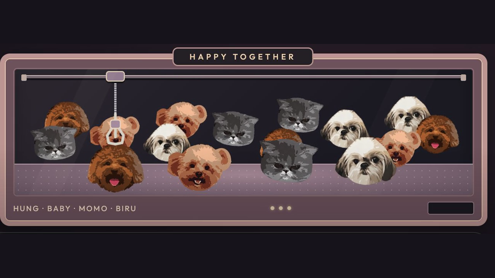

# Pet Claw Photo Studio

Turn four pet portraits into an animated claw-machine wallpaper. Choose your own PNG, JPG or WebP files, add names, adjust the crop and zoom, then download a standalone wallpaper or a CleanYourTV theme ZIP.

[Download v1.0.1](https://github.com/bypinkland-mi/pet-claw-photo-studio/releases/tag/v1.0.1) · [Watch the 48-second demo](https://github.com/bypinkland-mi/pet-claw-photo-studio/releases/download/v1.0.1/pet-claw-demo.mp4)

Version: **v1.0.1**. No account, API key, payment or installation is required for the editor.

## Put it on your LG TV with Claude / ChatGPT

**Start here: [AI-assisted installation guide + copy/paste prompt](INSTALL_WITH_AI.md).** It explains which file to download, how your assistant obtains the LG CleanYourTV source, and which steps you perform on the TV.

The flow is **four photos → theme ZIP → Claude/ChatGPT with local tools → combine with the LG launcher → build/install IPK → confirm on your TV**. This download is the editor/theme; the full launcher is obtained separately from the credited upstream. A plain chat without computer access can guide you, but cannot install it for you.

**繁中：[安裝步驟＋可直接貼畀 Claude／ChatGPT 嘅指令](INSTALL_WITH_AI.md)**。先用 editor 換四張相、匯出 theme ZIP，再交畀有本機權限嘅 AI 協助整合。LG 登入、Developer Mode 同電視確認由你操作。

## Download and use

1. Download **`index.html`** from this repository's GitHub **Releases** assets, or extract it from the source/release ZIP. Open the downloaded file directly in a recent desktop browser. GitHub's file viewer shows the source; download the file to run it.
2. Replace each of the **four** sample portraits with your own PNG, JPG/JPEG or WebP image. Each file may be up to 10 MB. Use images you own or have permission to use.
3. Set each pet's name. Open **Crop & framing** to adjust zoom, horizontal/vertical position and **Circle crop**. Transparent PNGs can keep their existing cutout; circle cropping works well for normal photos. There is no automatic AI background removal.
4. Choose **Download wallpaper HTML** or **CleanYourTV theme ZIP**. Exported files contain the selected portraits; review them before sharing.

The downloaded `index.html` is self-contained. It is designed to keep selected photos in browser memory without uploading or retaining them. Reloading the editor starts over. See [PRIVACY.md](PRIVACY.md) for export and hosting boundaries.

## What the exports do

| Export | Use |
| --- | --- |
| `pet-claw-wallpaper.html` | Open locally in a browser for the animated wallpaper. Contains the chosen portraits and the animation. |
| `pet-claw-cleanyourtv-theme.zip` | Theme assets and integration instructions for the tested LG webOS port of CleanYourTV. Adds theme CSS, configuration, JavaScript and a portrait atlas to a compatible launcher source build. |

The theme ZIP customizes an existing app. It does not replace the TV operating system or stock Home screen, root a TV, remove apps, package an SDK, or include a preinstalled TV/IPK. Follow the ZIP's integration instructions and keep a backup of your existing launcher before changing it. Other CleanYourTV variants and TV models need their own compatibility checks.

For LG device testing, use LG's official [Developer Mode guide](https://webostv.developer.lge.com/develop/getting-started/developer-mode-app). Device installation is separate from this browser editor; Developer Mode sessions can expire.

## Samples, credits and licenses

**The default pet illustrations are AI-generated with OpenAI from owner-provided reference imagery, reviewed and prepared by Sammi / byPINKLAND.** They are included with the owner's public-demo permission. They are not a general stock-image pack; see [MEDIA.md](MEDIA.md). Replace the samples with your own images for your own shared or commercial theme.

Software and documentation: [MIT](LICENSE), with upstream notices preserved. The launcher lineage is [Gathin's CleanYourTV / tv-vibehack](https://github.com/Gathin23/cleanyourtv) and [OmkarK97's LG webOS port](https://github.com/OmkarK97/webos-vibehack), pinned to `31a518aef23768067975f3ac2e464462a8046bab` for this integration. Bundled wallpaper Outfit font: SIL OFL 1.1. See [THIRD_PARTY_NOTICES.md](THIRD_PARTY_NOTICES.md).

Independent project by byPINKLAND; no affiliation or endorsement by CleanYourTV's authors, LG or OpenAI is implied. Household TV inventories, app logos, connection profiles and keys are excluded.

## 繁體中文快速開始

1. 喺 GitHub Releases 下載 `index.html`，直接用電腦瀏覽器開啟。
2. 換入四張自己有使用權嘅 PNG／JPG／WebP，輸入名字，再調整位置、縮放同圓形裁切。
3. 透明 PNG 可保留原有去背效果；一般相片可用圓形裁切，程式唔會自動 AI 去背。
4. 下載獨立 wallpaper HTML，或者 CleanYourTV theme ZIP。ZIP 係現有 launcher 嘅主題整合素材，唔係更換電視 OS。

相片設計上只喺瀏覽器記憶體處理；下載檔案會包含你揀嘅圖片。預設寵物圖係 AI 生成示範素材，使用範圍見 [MEDIA.md](MEDIA.md)。

## Release verification

v1.0.1 adds installation documentation, AI prompts, and the same instructions inside newly exported theme ZIPs. It does not bundle the launcher or change TV control behavior. The editor export was rechecked for the new README; the broader UI checks below are the v1.0.0 baseline.

Checked on 25 October 2026 in a desktop Chromium-based browser: four synthetic PNG replacements, name editing (including HTML-like input rendered literally), zoom/pan/circle controls, pause/resume, HTML and ZIP downloads, and reload returning to the samples. The downloaded custom HTML was byte-for-byte identical to the document rendered in the preview. Both default and custom ZIPs passed manifest, notice-byte, PNG-size and CRC checks. Source allowlist/privacy checks passed; inline scripts passed JavaScript syntax checks.

The editor contains no photo-upload, analytics or persistent-storage calls; its CSP blocks outbound connections. This is a source/CSP audit plus observed browser behavior, not a packet capture. Direct file-URL reopening and a 390px browser viewport could not be exercised by the automated browser environment; no mobile-device acceptance is claimed. The wallpaper's viewport-fit calculations are checked separately. Test a downloaded file in your preferred browser before relying on it.

The demo is a screen recording of the accepted animation, cropped to the machine. Capture averaged about 7.6 frames/s; the 1280×720 MP4 repeats frames at 30 fps. It is silent and 48.1 seconds long. It is not a recording of a TV camera or an interactive game. The generalized theme export has not been installed on a second TV; installation remains a separate step.

Build with `python3 scripts/build.py`. Run public-source checks with `python3 tests/check-release.py`; optionally add `--theme /path/to/exported-theme.zip`.
